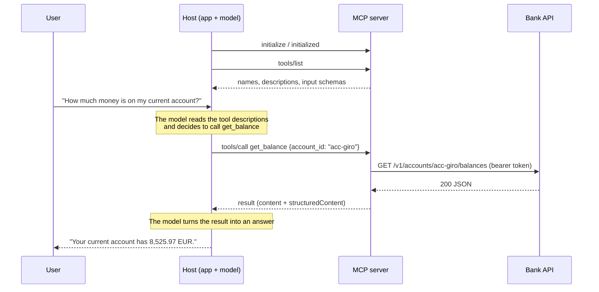

# 2. Tools, resources and prompts

An MCP server can offer three kinds of capabilities. What distinguishes them is who decides
when they are used:

| Kind | Controlled by | What it is | In this project |
| --- | --- | --- | --- |
| **Tool** | The model | A function the model may call, with arguments, to read data or act | `list_accounts`, `get_balance`, `search_transactions` |
| **Resource** | The application | Read-only content with a URI, loaded into the context by the host | `bank://fees`, `bank://faq` |
| **Prompt** | The user | A reusable template the user picks explicitly, like a slash command | `monthly_summary(month)` |

All three are registered with a decorator in [`server.py`](../../src/demo_bank_mcp/server.py):
`@mcp.tool()`, `@mcp.resource("bank://fees")` and `@mcp.prompt()`. The decorated function stays
an ordinary Python function.

## How a tool call flows



Three steps matter:

1. **Discovery.** The host calls `tools/list` once and hands the descriptions and schemas to the
   model. This is the only documentation the model ever gets.
2. **Call.** The model produces a tool name and arguments. The host forwards them as `tools/call`.
   Nothing is executed by the model itself; the host and the server do the work.
3. **Result.** The server returns the result. The model reads it and continues. A failure is
   returned as a normal result with `isError: true`, so the model can see the message and react.

## From Python function to schema

The host never sees Python. It sees JSON that FastMCP generates from the function. This is
`get_balance` in the code:

```python
AccountId = Annotated[str, Field(description='Account id from list_accounts, e.g. "acc-giro".')]


@mcp.tool()
def get_balance(account_id: AccountId) -> Balance:
    """Get the current booked balance of one account."""
```

And this is what the server answers to `tools/list` for it (captured from the running server;
the entry is shortened to the first output field):

```json
{
  "name": "get_balance",
  "description": "Get the current booked balance of one account.",
  "inputSchema": {
    "type": "object",
    "title": "get_balanceArguments",
    "properties": {
      "account_id": {
        "type": "string",
        "title": "Account Id",
        "description": "Account id from list_accounts, e.g. \"acc-giro\"."
      }
    },
    "required": ["account_id"]
  },
  "outputSchema": {
    "type": "object",
    "title": "Balance",
    "properties": {
      "account_id": {"type": "string", "title": "Account Id"},
      "...": "iban, balance_type, amount, currency"
    },
    "required": ["account_id", "iban", "balance_type", "amount", "currency"]
  }
}
```

| Python | JSON the host receives |
| --- | --- |
| Function name | `name` |
| Docstring | `description`: the text the model uses to decide when to call the tool |
| Parameter names and type hints | `inputSchema.properties` and their `type` (a `date` becomes `"format": "date"`) |
| Parameter without a default | entry in `inputSchema.required` |
| `Annotated[..., Field(description=...)]` | per-parameter `description` |
| Return annotation (a Pydantic model) | `outputSchema` |

So a docstring and a type hint are the API documentation for the model. A vague docstring or a
missing parameter description leads to wrong tool choices and wrong arguments, which makes this
the most important text in the project.

The result of a call, as the server sends it for `{"account_id": "acc-giro"}`:

```json
{
  "content": [{"type": "text", "text": "{\"account_id\": \"acc-giro\", \"iban\": \"DE00 **** **** 0101\", ...}"}],
  "structuredContent": {
    "account_id": "acc-giro",
    "iban": "DE00 **** **** 0101",
    "balance_type": "closingBooked",
    "amount": "8525.97",
    "currency": "EUR"
  },
  "isError": false
}
```

`structuredContent` is validated against `outputSchema`. `content` carries the same data as text
for hosts that cannot use structured results.

## Designing the tools

- **Compact results.** [`client.py`](../../src/demo_bank_mcp/client.py) reduces the verbose API
  responses to the few fields a model needs. `search_transactions` returns at most 50 rows plus
  `total_matches`, so one call cannot flood the context window.
- **Masked data.** IBANs leave the server as `DE00 **** **** 0101`
  ([`security.py`](../../src/demo_bank_mcp/security.py)). What the model never receives cannot
  leak into a transcript.
- **Errors the model can act on.** An unknown account becomes
  `Bank API error 404: Account not found`, returned with `isError: true`.
- **Read-only token.** The read tools use a token with only the `accounts:read` scope. The transfer tools in [guide 3](03-write-flow-and-confirmation.md) use a separate token.

## Resources and prompts

A resource is read with `resources/read`; the host decides whether to show it to the user or to
put it into the model's context. Both resources here are static markdown with a `text/markdown`
MIME type.

A prompt is fetched with `prompts/get` and arguments. For `monthly_summary` with
`{"month": "2026-05"}` the host receives a ready-made user message that tells the model to call
`list_accounts` and `search_transactions` for 2026-05-01 to 2026-05-31 and to summarise the
result. The prompt contains no data itself; it steers the model towards the tools.

Try it all in the MCP Inspector: `uv run mcp dev src/demo_bank_mcp/server.py`, with the mock API
running and `.env` in place.
