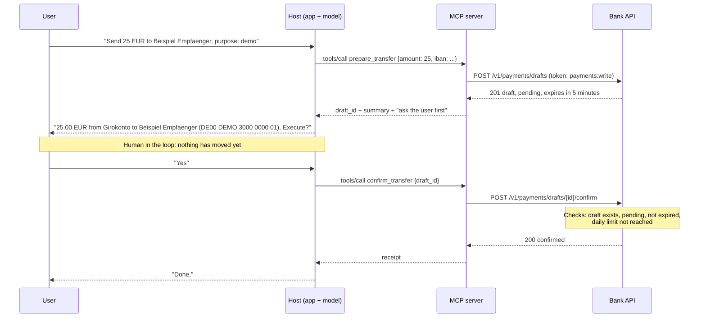

# 3. The write flow and confirmation

Reading data is harmless. A tool that moves money is not: a model can misunderstand a request,
invent an argument, or be tricked by text it read earlier. So no money-moving tool in this
project acts in one step. A transfer takes two tools and a human in between.

## Two steps: prepare, then confirm

| Tool | What it does | Moves money? |
| --- | --- | --- |
| `prepare_transfer(from_account_id, recipient_name, iban, amount, purpose)` | Creates a **draft** at the bank and returns a human-readable `summary`, the `draft_id` and the expiry time | No |
| `confirm_transfer(draft_id)` | Executes an existing, unexpired draft | Yes |

The mock API is the authority on what is allowed. In
[`mock_bank/app.py`](../../mock_bank/app.py), `confirm_draft` is the only place where money
"moves", and it refuses unless all of these hold:

- the draft exists (otherwise 404),
- it is still `pending`, so a draft can be confirmed only once (otherwise 409),
- it is not older than 5 minutes (otherwise 410; the draft becomes `expired`),
- fewer than 3 transfers were executed today (otherwise 429).

The per-transfer limit of 1,000 EUR is checked when the draft is created (422). The expiry is
what makes a confirmation mean something: it ties the user's "yes" to a recent summary instead
of a draft that sits around for days. The API takes its clock as a parameter, which is how the
tests check expiry without waiting five minutes.

The server reports each refusal as a tool error with the bank's message, for example
`Bank API error 429: Daily limit reached: at most 3 transfers per day`, so the model can tell the
user what happened instead of guessing.

## Human in the loop

MCP does not decide how a host asks the user. The protocol only moves messages; the host is
the application the user talks to. What the server can do is make asking the natural thing:

- The tool descriptions tell the model to show the summary and to call `confirm_transfer` only
  after the user has explicitly agreed. The result of `prepare_transfer` repeats this as
  `next_step`, at the moment it matters.
- The summary is written by the server from what the bank stored, not by the model, and it shows
  the recipient name and IBAN in full: the one thing a user must be able to check. The user's own
  account stays masked.

These are requests to a model, not guarantees. A model can ignore them. This is why the
authoritative checks live in the API, and why the least-privilege split below exists.

## Least privilege: two tokens

The server holds two clients ([`server.py`](../../src/demo_bank_mcp/server.py)). The read tools
use the token with scope `accounts:read`. Only `prepare_transfer` and `confirm_transfer` use the
token with `payments:write`. A bug in a read tool therefore cannot create a payment, and the
split is visible in the code: `get_client()` versus `get_write_client()`.

## Tool annotations

Tools can carry hints about their behaviour (`ToolAnnotations` in the SDK). They are sent with
`tools/list`:

| Tool | `readOnlyHint` | `destructiveHint` |
| --- | --- | --- |
| `list_accounts`, `get_balance`, `search_transactions` | true | - |
| `prepare_transfer` | false | false (it only creates a draft) |
| `confirm_transfer` | false | true |

A host can use them, for example to run read-only tools without a prompt and to always ask
before a destructive one. They are hints: the protocol says clients should not trust them from
an untrusted server, and this server does not depend on them for safety.

## Elicitation (not used here)

MCP also has elicitation: during a tool call, the server can ask the host to put a question to
the user directly, bypassing the model. `confirm_transfer` could use it to show the summary and
wait for a yes or no itself. That would be a stronger form of human-in-the-loop, because the model
could not answer for the user. It is left out on purpose: it needs host support that is not
universal, and the two-step flow works on every host. It would be an addition, not a replacement:
the draft, the expiry and the limits would stay.

## Try it

With the mock API running and `.env` in place, open the inspector with
`uv run mcp dev src/demo_bank_mcp/server.py`, call `prepare_transfer` with 25 EUR, then
`confirm_transfer` with the returned id. Then try the failures: confirm the same id again, prepare
5000 EUR, or wait five minutes before confirming. The inspector runs through `npx`, so it needs
Node.js.
